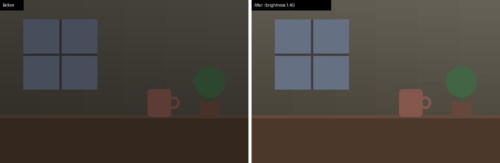
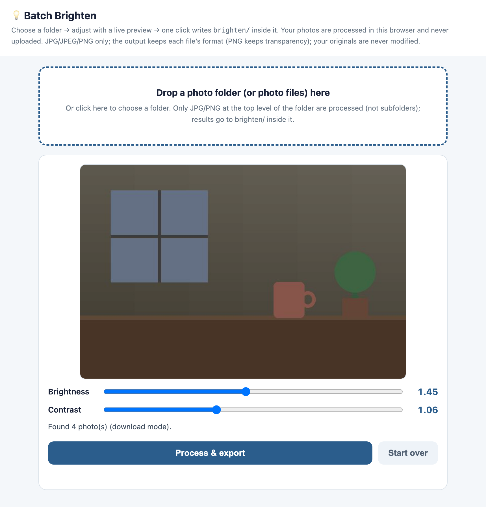

# Photo Brighten 批次調亮——一次救回整個資料夾的暗照片

把資料夾裡的 JPEG／PNG 全部調亮，輸出到旁邊的 `brighten/` 資料夾。
**原始照片永遠不會被修改；你選的照片只在你自己的電腦上處理，不會上傳。**

**線上 demo：**<https://nullinbetween.github.io/photo-brighten/>——Chrome／Edge 可用資料夾模式；其他瀏覽器改用下載模式（測試中以模擬方式涵蓋，尚未在真正的 Safari／Firefox 上試過）。照片只在瀏覽器裡處理，不會上傳。

[English → README.md](README.md)



*右半邊是 `brighten.py` 實際處理合成測試圖產生的結果（`docs/make_before_after.py`）。*

兩種用法：

| | 瀏覽器版 `batch-brighten.html` | 腳本版 `brighten.py`／`batch-brighten.command` |
|---|---|---|
| 怎麼開 | 打開 HTML | `python3 brighten.py 資料夾`，或在 macOS 雙擊 `.command` |
| 可調 | 亮度＋對比滑桿，即時預覽 | 只有亮度 |
| 預設值 | 亮度 1.45、對比 1.06 | 亮度 1.45 |
| 子資料夾 | 只處理所選資料夾的第一層 | 往下最多 5 層，保留結構 |
| 輸出 | Chrome／Edge：寫入 `brighten/`。Safari／Firefox：每張發起一次下載 | 一律寫入 `brighten/` |
| 需要 | 瀏覽器 | Python 3.9+ 與 Pillow |



---

## 設計筆記——我們怎麼想的

| 決定 | 為什麼 | 我們接受的代價 |
|---|---|---|
| **不碰原檔，輸出到 `brighten/`** | 跑兩次也安全、方便並排比較，「復原」就是刪掉一個資料夾。腳本版也會拒絕透過 `brighten/` 裡指回原檔的捷徑（symbolic link）寫入。 | 多占一些磁碟空間。 |
| **每次都問亮度** | 每批照片的光線都不一樣，固定一個值有一半的時候是錯的。 | 每次多一個問題。 |
| **兩種入口** | 瀏覽器版不用安裝、看得到即時效果；腳本版不用開任何東西，處理多層資料夾。 | 兩套實作；差異直接列在上表，不隱藏。 |
| **輸出格式跟檔名走** | `.png` 裡面就該是 PNG，而且要保留透明度。原版瀏覽器版把 JPEG 寫進 `.png` 檔，腳本版把透明度丟掉。 | 檔名與內容不符的輸入，會被轉成和檔名一致的格式。 |
| **用逐像素查表調亮，不用 canvas 的 `filter`** | 部分瀏覽器（Safari）會默默忽略 `ctx.filter`：畫面說「完成」，但每張輸出都沒變。查表只用到標準的像素存取，也和腳本版用的是同一種乘法。已在 Chromium（含模擬 Safari 流程）測試；尚未在真正的 Safari／Firefox 上測試。 | 程式碼多一點。 |
| **套用 EXIF 方向，然後不保留 EXIF** | 直拍照片不會躺下；分享出去的副本也不會帶著拍攝地點（GPS）。 | 不保留相機資訊。 |
| **誠實回報失敗** | 原本壞檔也算成功（瀏覽器版還可能永遠卡住）。現在每個檔不是寫出成功（下載模式下是交給瀏覽器下載），就是列在失敗清單並附原因。 | — |
| **覆寫前先說** | 重跑會覆寫 `brighten/` 裡的同名檔；處理前後都會顯示數量。 | 沒有逐檔「兩者都保留」的選項。 |
| **絕不偷偷安裝套件** | 原版腳本每次啟動都會跑 `pip install`。安裝應該由你決定；實測版本固定在 `requirements.txt`。 | 第一次要手動裝一次。 |

## 教學

練習用的圖在 [`examples/sample-photos/`](examples/sample-photos/)——程式產生的色塊和漸層（不是照片），包含透明 PNG、調色盤 PNG、帶 EXIF 旋轉的 JPEG、多層資料夾與大寫副檔名。

### A. 瀏覽器版（不用安裝）

1. 用 **Chrome 或 Edge** 打開 `batch-brighten.html`。
2. 點虛線框選擇照片資料夾（或直接把資料夾拖進去）。
3. 一邊看預覽一邊調 **Brightness**（亮度）與 **Contrast**（對比）。工具介面是英文。
4. 按 **Process & export**。結果會出現在所選資料夾裡新的 `brighten/`；訊息會列出成功、失敗、覆寫了幾張。

**Safari 或 Firefox**（不能存取資料夾）：點框選擇照片**檔案**（可多選）再按按鈕，每張結果會各自交給瀏覽器下載。瀏覽器可能會詢問一次是否允許下載多個檔案。
頁面只知道「已發起下載」，無法確認每個檔案都存好了，請到下載資料夾確認。（這個模式有模擬測試，尚未在真正的 Safari 或 Firefox 上試過。）

### B. 腳本版（任何有 Python 的系統）——已在 macOS 實測

```bash
python3 -m pip install --user -r requirements.txt
python3 brighten.py examples/sample-photos --brightness 1.45
```

輸出：

```
📂 Found 7 image(s) including subfolders → writing to …/examples/sample-photos/brighten/
Done: 7 succeeded / 0 failed / 7 total (0 overwritten) → …/examples/sample-photos/brighten/
```

結束代碼 `0` = 全部成功、`1` = 有失敗、`2` = 參數錯誤或缺少 Pillow。亮度必須介於 0.1–5.0。

### C. macOS 雙擊

雙擊 `batch-brighten.command`：它會先檢查 Pillow（缺少時只顯示安裝指令，不會自動安裝）、詢問資料夾與亮度，再執行 `brighten.py`。

如果 macOS 不讓你打開從網路下載的 `.command`，可以在終端機執行——

```bash
bash batch-brighten.command
```

——或到**系統設定 → 隱私權與安全性 → 強制打開（Open Anyway）**允許一次。（這是 macOS 對未簽署下載檔的標準行為；測試時沒有用實際下載的副本重現。）

## 兩種版本都遵守的規則

- 只處理 `.jpg`、`.jpeg`、`.png`（大小寫皆可）。`._IMG_0001.JPG` 這類隱藏檔與名為 `brighten` 的資料夾會略過。
- `.png` → 保留透明度的 PNG（alpha 通道，或調色盤／RGB／灰階 PNG 的 tRNS 透明色都保留）；`.jpg`／`.jpeg` → 品質 95 的 JPEG。
- 亮度 = 每個 RGB 值乘以倍數（1.0 = 不變，超過 255 截為 255）；alpha 永遠不動。
- 瀏覽器版在亮度之後以 50% 灰為中心調對比，輸出為不含 ICC 的 sRGB；腳本版保留原檔的 RGB 色彩描述檔。廣色域照片兩者看起來可能略有差異。

## 測試

```bash
python3 -m unittest discover -s tests -v          # 腳本版 18 項
python3 -m http.server 8765 --bind 127.0.0.1      # 再開 /tests/core.test.html——瀏覽器版 10 項
```

瀏覽器測試包含模擬 Safari（移除資料夾存取 → 選檔 → 逐張下載）。

## 從個人工具到開源

原版是一個順手的小工具：一個 HTML 和一個把 Python 寫在裡面的雙擊腳本。為了公開，我們先修好仔細閱讀後找到的問題——PNG 輸出格式錯誤、透明度遺失、Safari 點擊沒反應、失敗算成功、直拍照片躺下、Safari 輸出沒變化、靜默 `pip install`——再把處理邏輯抽成可測試的 `brighten.py`、寫清楚兩種版本的差異，並用程式產生的測試圖取代真實照片。已知限制見 [`ISSUES.md`](ISSUES.md)。

## 製作方式

由作者設計，程式以 AI 程式助手協作寫成。開源準備是一個小型多代理流程：**Codex** 負責界定範圍並獨立驗收，**Claude** 負責依白名單複製、修正缺陷、撰寫測試與文件，最終決定由作者做出。

## 授權

[MIT](LICENSE)。腳本版使用 [Pillow](https://pypi.org/project/pillow/)（MIT-CMU），由使用者自行安裝、不隨本專案散布——見 [`ASSET_REGISTER.md`](ASSET_REGISTER.md)。

---

Made by [@nullinbetween](https://x.com/nullinbetween) · apps by meredith · [appsbymeredith.carrd.co](https://appsbymeredith.carrd.co)
